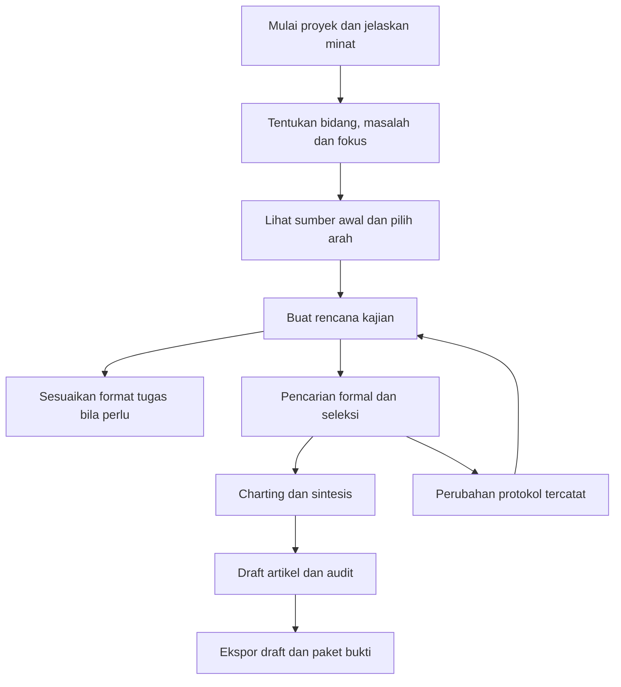

# 02. Workflow Mahasiswa dari Awal hingga Draft

Alur ini adalah pengalaman standar bagi mahasiswa yang baru pertama kali melakukan kajian. VERA memperkenalkan istilah saat berguna dan menjelaskan alasan tiap langkah. Jika mahasiswa membawa instruksi perkuliahan, VERA dapat membantu menyesuaikan dokumen dengan format yang diminta.

## Peta perjalanan

## Tahap aktivitas dan gate

| Tahap | Mahasiswa mengerjakan | Bantuan VERA | Keluaran | Gate untuk mengesahkan tahap |
|---|---|---|---|---|
| Menentukan arah | Menceritakan minat, pengalaman, masalah dan hal yang ingin dipahami | Mengklarifikasi jawaban dan memberi beberapa pilihan fokus | Ringkasan arah kajian | Mahasiswa memilih fokus sementara dan alasannya |
| Mempersempit pertanyaan | Menentukan siapa atau apa yang dikaji, hal yang ingin dipetakan dan konteksnya | Menjelaskan unsur pertanyaan dan menguji cakupannya | Pertanyaan dan judul kerja | Tujuan dan pertanyaan saling sesuai |
| Membuat rencana kajian | Menentukan sumber yang dicari, cara memilih, informasi yang dicatat dan cara merangkum | Menjelaskan istilah seperti protokol dan memberi peringatan konsistensi | Versi rencana kajian | Keputusan penting terisi atau ditandai belum diputuskan |
| Menyesuaikan keluaran tugas, bila perlu | Memilih instruksi/rubrik dan memastikan pemetaan bagian | Menghubungkan format tugas dengan data yang sudah dibuat | Dokumen sesuai tugas | Pengguna meninjau format dan berkas yang diminta |
| Pencarian | Menyetujui query per database dan menjalankan | Mengadaptasi sintaks dan mencatat hasil | SearchRun dan RecordOccurrence | Setiap run dinyatakan lengkap, gagal atau parsial; cakupan disetujui |
| Seleksi | Menilai judul-abstrak dan teks lengkap | Menunjukkan bukti dan kriteria setelah judgement | ScreeningDecision dan FullTextAssessment | Konflik teratasi; sumber belum diperoleh memiliki status terpisah |
| Charting | Menguji form, mengisi dan mengonfirmasi data | Usulan dengan lokasi sumber | ChartingRow | Item wajib terisi, tidak dilaporkan, atau tidak berlaku; semua ditinjau |
| Sintesis | Membentuk kategori, tabel dan interpretasi | Menghitung dari dataset terkonfirmasi | SynthesisVersion | Setiap temuan dapat ditelusuri ke baris dan sumber |
| Draft | Menulis dan merevisi bagian artikel | Kerangka dan bantuan bahasa berbasis bukti | DraftVersion | Status klaim, sitasi dan kekurangan terlihat |
| Audit | Memeriksa checklist, angka dan hubungan metode-hasil | Pemeriksaan deterministik dan usulan perbaikan | AuditReport dan ExportManifest | Tidak ada klaim status selesai yang menutupi kekurangan |

Gate membatasi status penyelesaian dan tindakan yang memerlukan data, bukan melarang melihat layar. Tahap belum tersedia harus menjelaskan apa yang perlu diselesaikan. Mahasiswa boleh membuka editor sejak awal untuk mencatat pendahuluan.

## Penjelasan bertahap untuk istilah dan keputusan

Di layar, VERA memulai dengan bahasa sehari-hari. Contoh: **Siapa atau hal apa yang ingin Anda kaji?** Baru setelah jawaban diberikan, sistem memberi label opsional *Population/Participants*. Untuk **Apa yang ingin Anda petakan?**, sistem menjelaskan istilah *Concept*. Untuk **Dalam keadaan atau lingkungan apa?**, sistem memperkenalkan *Context*. Pengguna tidak perlu menghafal singkatan PCC.

Begitu pula, layar bertanya **Bagaimana Anda akan mencari dan memilih sumber?** sebelum menyebut rencana tersebut sebagai protokol. Ketika perlu melaporkan artikel, aplikasi menjelaskan bahwa PRISMA-ScR adalah checklist pelaporan Scoping Review. VERA membedakan panduan pelaksanaan metode dan panduan pelaporan artikel.

## Satu pola interaksi untuk keputusan penting

1. Mahasiswa mencatat keputusan dan alasan awal. Keyakinan 0 sampai 100 bersifat opsional dalam penggunaan normal dan dapat diwajibkan dalam protokol studi pembelajaran.
2. VERA menyajikan informasi yang relevan, sumber dan pertanyaan pemeriksaan.
3. Mahasiswa menerima, menolak, merevisi atau menunda saran dengan alasan singkat.
4. Sistem menyimpan keputusan awal dan keputusan akhir sebagai entri berbeda. Riwayat awal tidak ditimpa.

Tidak setiap keputusan memerlukan semua kolom. Pemilihan bidang cukup alasan minat; screening memerlukan alasan berbasis kriteria; interpretasi memerlukan tautan bukti.

## Perubahan dan kelanjutan

Saat topik berubah sebelum protokol dikunci, data arah diperbarui melalui revisi. Setelah protokol menjadi acuan pencarian formal, perubahan Concept, kriteria atau query menghasilkan amendment. Sistem menampilkan dampak: run pencarian mungkin perlu diulang, keputusan seleksi perlu ditinjau, charting dan narasi menjadi usang.

Autosave harus memberi status tersimpan, menyimpan, gagal atau konflik. Setelah aplikasi ditutup, proyek kembali ke aktivitas terakhir beserta tugas tersisa. Kegagalan jaringan tidak boleh menghapus pekerjaan lokal. Proses panjang memiliki progres dan dapat dilanjutkan dari checkpoint.

## Selesai dalam arti apa?

Rencana kajian yang telah disusun belum berarti pencarian dan seleksi sudah dilakukan. Jika pengguna membawa instruksi perkuliahan, VERA dapat menyusun berkas sesuai format yang diminta. Jika tidak, mahasiswa tetap dapat melanjutkan memakai alur umum. Draft lengkap menggunakan metode aktual, hasil pemetaan, pembahasan dan referensi yang tersedia; audit dapat tetap menyatakan keterbatasan. Status siap ditinjau berarti draft dapat diberikan kepada pembimbing. Tidak ada status otomatis yang menjamin penerimaan jurnal.
